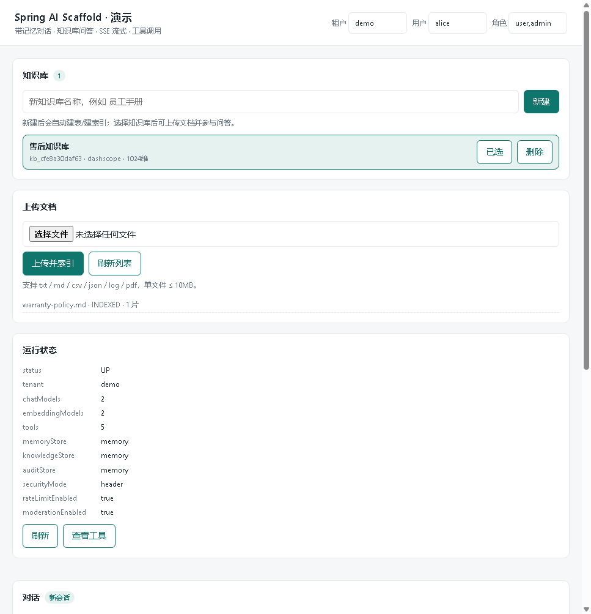
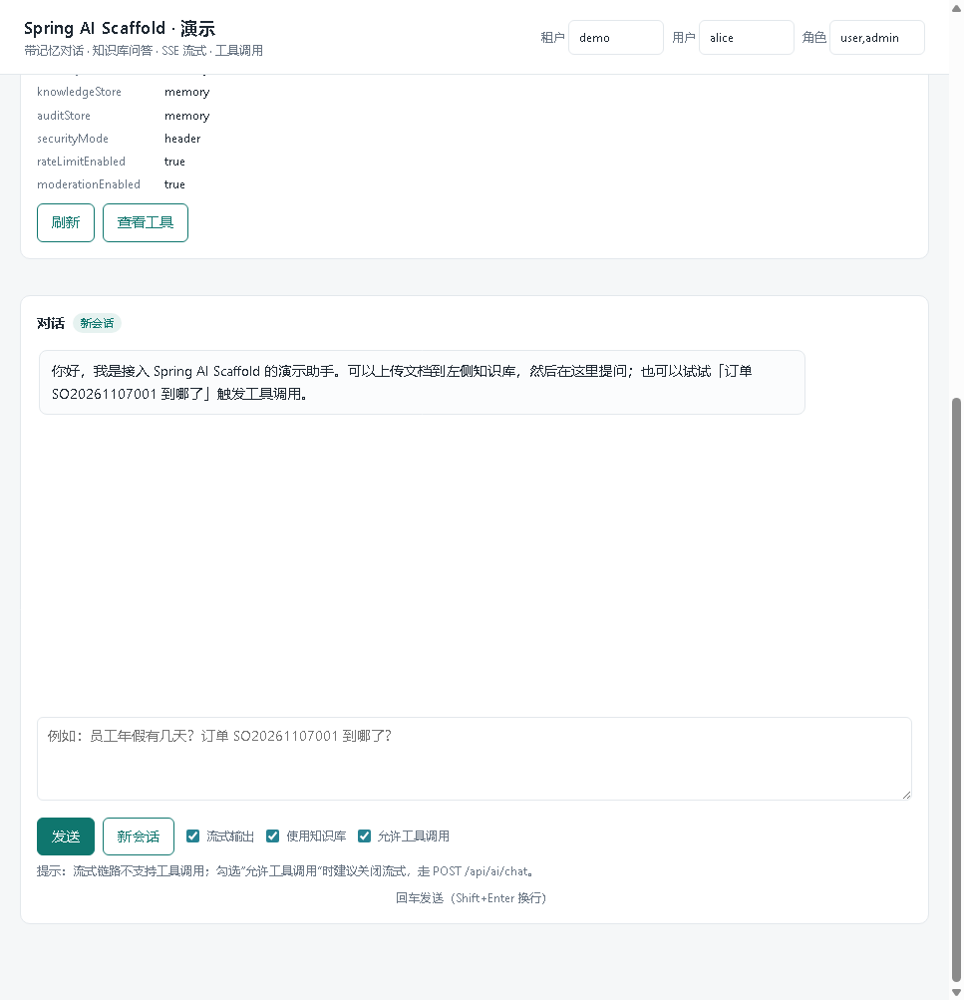

# spring-ai-scaffold

English | [简体中文](README.md)


A Spring Boot starter that gives you **chat with conversation memory plus working knowledge-base Q&A** out of the box — without any `spring-ai-*` dependency. Model calls go through the JDK's own `java.net.http.HttpClient`.

Built for the unglamorous cases: internal knowledge-base search, customer-support Q&A, a small internal Copilot. Something you can read end to end, change, and actually ship.

<p align="center">
  
  
</p>

<p align="center"><i>Real demo UI: upload a document, it gets chunked and indexed, then ask with "use knowledge base" enabled. Screenshots were taken against the bundled mock model, so no API credits were spent.</i></p>

```
Your app (Spring Boot)  ──depends on──>  spring-ai-scaffold-starter
                                              │
                                              ├─ model    unified model layer (OpenAI-compatible / DashScope native / Ollama)
                                              ├─ memory   conversation memory (in-memory / Redis / JDBC)
                                              ├─ rag      upload → split → embed → retrieve
                                              ├─ chat     orchestration: rate limit → moderation → retrieval → tool loop → persist
                                              ├─ tool     @AiTool function calling
                                              └─ web      /chat, /chat/stream (SSE), /kb …
```

## Why not Spring AI

- **Small dependency tree.** No `spring-ai-*` transitive graph; less to conflict with.
- **Protocols are readable.** Request building, SSE parsing and error mapping live in this repo, so you can fix them directly.
- **Cheap to re-point.** Most provider switches are two values: `base-url` and `chat-model`.

The trade-off: you don't get Spring AI's Advisor / VectorStore ecosystem. Multimodal and complex pipelines are on you.

## What's included / what's not

| Capability | This repo (open source) | Enterprise edition (private) |
| --- | --- | --- |
| Chat: non-streaming + SSE | Yes | Yes |
| Conversation memory (memory / Redis / JDBC) | Yes | Yes |
| Model layer (OpenAI-compatible / DashScope native / Ollama) | Yes | Yes |
| Knowledge base: upload → split → embed → retrieve | Yes (memory / pgvector / Redis) | Yes |
| Hybrid retrieval (vector + keyword) | Yes | Yes |
| `@AiTool` function calling + built-in tools | Yes (reflection based) | Yes |
| Rate limiting / keyword moderation / audit / token stats | Yes (local implementations) | Distributed variants |
| Tenant isolation | Header pass-through (`X-Tenant-Id`) | API Key auth + RBAC |
| LLM reranking | Interface + `NoopReranker` only | `LlmReranker` |
| Prompt versioning (publish / canary / rollback) | Read-only `prompts/*.md` | Multi-version `ai_prompt` table |
| Supervisor agent / task planning | No | Yes |
| MCP tool integration | No | Yes |
| Auto evaluation / hallucination checks | No | Yes |
| Circuit breaker / model fallback | No | Yes |
| Billing / API Key / admin console | No | Yes |

## Quick start

Requirements: JDK 17+, Maven 3.9+.

```bash
# 1. API key (DashScope / Alibaba Cloud Bailian)
export DASHSCOPE_API_KEY=sk-xxx      # PowerShell: $env:DASHSCOPE_API_KEY = "sk-xxx"

# 2. Build
mvn -B -DskipTests package

# 3. Run the demo
java -jar spring-ai-scaffold-demo/target/spring-ai-scaffold-demo-1.0.0.jar
```

Open http://localhost:8080, then:

1. Create a knowledge base and upload a `.txt` / `.md` / `.pdf` — it is chunked and embedded automatically;
2. Ask a question with "use knowledge base" checked to get an answer with citations;
3. Toggle streaming to watch the SSE stream.

Health and self-check endpoints:

```bash
curl http://localhost:8080/api/ai/health -H "X-Tenant-Id: demo"
curl http://localhost:8080/api/ai/models -H "X-Tenant-Id: demo"
```

Verify that every configured model actually exists on its endpoint:

```bash
powershell -File scripts/check-models.ps1     # one real request per model, PASS/FAIL per line
```

No key at hand? Run the bundled mock and point a model at it:

```bash
python scripts/mock-model-server.py 9999
# base-url: http://127.0.0.1:9999  (OpenAI-compatible)
# base-url: http://127.0.0.1:9999/api/v1  (DashScope native)
```

## Add it to your project

```xml
<dependency>
    <groupId>com.scaffoldai</groupId>
    <artifactId>spring-ai-scaffold-starter</artifactId>
    <version>1.0.0</version>
</dependency>
```

Auto-configuration registers `ChatService`, `Retriever`, `KnowledgeBaseService` and friends — inject them and go. Set `ai.scaffold.web.enabled=false` if you only want the SDK and no HTTP endpoints.

## Configuration

Minimal setup, single provider:

```yaml
ai:
  scaffold:
    default-chat-model: dashscope
    default-embedding-model: dashscope
    models:
      dashscope:
        type: dashscope                        # openai-compatible / dashscope / dashscope-native / ollama
        base-url: https://dashscope.aliyuncs.com/compatible-mode/v1
        api-key: ${DASHSCOPE_API_KEY:}
        chat-model: qwen-plus                  # the provider's real model name, never a logical alias
        embedding-model: text-embedding-v4
        embedding-dimension: 1024
```

### Per-model keys (`models.<name>`)

| Key | Meaning |
| --- | --- |
| `type` | `openai-compatible`, `dashscope` (compatible mode, same wire format), `dashscope-native` (DashScope native `/services/aigc/text-generation/generation`), `ollama` |
| `base-url` | Endpoint root; `.../compatible-mode/v1` for `dashscope`, `.../api/v1` for `dashscope-native` |
| `api-key` | Use an env placeholder; never commit a real key |
| `chat-model` | **Provider's real model name** (`qwen-plus`, `qwen3.5-122b-a10b`, `qwen2.5:7b`) |
| `embedding-model` / `embedding-dimension` | Must stay consistent with the dimension used when the knowledge base was built |
| `temperature` / `max-tokens` / `timeout-seconds` / `connect-timeout-seconds` | Sampling and timeouts |
| `enabled` | Set `false` to skip registration |

`<name>` is a **logical alias** used for routing and auditing only; the `model` field in the HTTP body always carries `chat-model`.

### Other sections

| Key | Default | Meaning |
| --- | --- | --- |
| `chat.max-tool-rounds` | 4 | Max tool-calling rounds |
| `chat.history-window` | 20 | History messages fed into context |
| `chat.sse-timeout-seconds` | 120 | SSE timeout |
| `chat.stream-executor-size` | 8 | Streaming pool size |
| `memory.store` | auto | `memory` / `redis` / `jdbc` / `auto` |
| `rag.store` | auto | `memory` / `pgvector` / `redis` / `auto` |
| `rag.top-k` / `rag.min-score` | 5 / 0.45 | Recall size and similarity threshold |
| `rag.chunk-size` / `rag.chunk-overlap` | 900 / 150 | Chunking |
| `rag.hybrid-enabled` | true | Vector + keyword recall combined |
| `security.mode` | header | Header pass-through only in this edition |
| `security.default-tenant` / `default-user` / `default-roles` | public / anonymous / user | Fallback identity |
| `rate-limit.enabled` / `tenant-rpm` / `user-rpm` | true / 600 / 60 | Local sliding-window limiter |
| `moderation.enabled` / `max-input-chars` / `blocked-words` | true / 4000 / — | Keyword moderation and length cap |
| `audit.enabled` / `store` / `truncate-length` | true / auto / 2000 | Audit trail |
| `web.base-path` | /api/ai | Endpoint prefix |
| `web.cors-allowed-origins` | * | Comma separated |

Storage guidance: `jdbc` for a single-node demo, `redis` for multiple instances, `pgvector` for production knowledge bases (`docker-compose.yml` is included).

## HTTP API

Everything sits under `${ai.scaffold.web.base-path}` (default `/api/ai`) and returns `{"ok":true,"code":"OK","data":…}`.

| Method | Path | Purpose |
| --- | --- | --- |
| POST | `/chat` | Non-streaming chat, supports RAG and tool calls |
| POST | `/chat/stream` | SSE streaming chat (no tool loop) |
| DELETE | `/chat/{conversationId}` | Clear one conversation's memory |
| GET | `/conversations` | Conversations of the current tenant |
| GET | `/conversations/{id}/messages` | Messages of one conversation |
| POST / GET | `/kb` | Create / list knowledge bases |
| GET / DELETE | `/kb/{kbId}` | Details / delete |
| POST | `/kb/{kbId}/documents` | Upload document (multipart, `.txt`/`.md`/`.pdf`) |
| GET / DELETE | `/kb/{kbId}/documents[/{docId}]` | List / details / delete |
| POST | `/kb/{kbId}/search` | Raw retrieval, for tuning recall |
| GET | `/kb/{kbId}/chunks/count` | Chunk count |
| GET | `/models` / `/tools` / `/health` | Self-check: models, tools, runtime state |

Request body for `POST /chat`:

```json
{
  "question": "How long does a refund take?",
  "conversationId": "c-1001",
  "model": "dashscope",
  "kbIds": ["kb-xxx"],
  "useRag": true,
  "useTools": true,
  "temperature": 0.3,
  "maxTokens": 1024,
  "systemPrompt": "You are a support agent"
}
```

`model` here is the **logical alias** (the key under `models`), not the provider model name.

Identity travels in headers: `X-Tenant-Id`, `X-User-Id`, `X-Roles`, falling back to configured defaults.

## Custom tools (`@AiTool`)

Annotate a method on any Spring bean and it is registered automatically:

```java
@Component
public class OrderTools {

    @AiTool(name = "order_status",
            description = "Look up shipping status by order number. Use it when the user asks where their parcel is.")
    public String orderStatus(@ToolParam("Order number, e.g. SO2026001") String orderNo) {
        return "SF1234567890 arrived at the local distribution center";
    }
}
```

Notes:

- `description` decides whether the model calls it correctly — describe *when* to use it, not just what it is;
- parameter names rely on `-parameters` at compile time (the parent POM already sets `maven.compiler.parameters=true`), otherwise they degrade to `arg0`;
- tool results are fed back for further reasoning, up to `chat.max-tool-rounds`;
- streaming does not run the tool loop; use the non-streaming endpoint when tools are needed.

Built-in tools: `current_time`, `shipping_fee`, `order_status`, `refund_request`, `knowledge_search` (demo implementations you are expected to replace).

## Logging and debugging

Default levels: `root=WARN`, `com.scaffoldai=INFO`. To see which model was used, its real name, the target URL and token usage:

```bash
java -jar spring-ai-scaffold-demo/target/spring-ai-scaffold-demo-1.0.0.jar --logging.level.com.scaffoldai=debug
```

**Gotcha**: do not set an explicit level on a child logger (e.g. `com.scaffoldai.chat`, `com.scaffoldai.model`) in YAML — a child logger's explicit level overrides the parent's DEBUG and silently disables the command-line switch above.

Metrics (token counts, call counts) are exposed through Micrometer at `/actuator/metrics`.

## Known limitations

- **No tool loop in SSE**: streaming is single-round completion. Use `POST /chat` when tools are required.
- **In-process stores by default**: `rag.store=memory` loses the knowledge base on restart, same for `memory.store=memory`.
- **No reranking**: only `NoopReranker` (original order); implement a `Reranker` bean to override.
- **No authentication**: header pass-through trusts the upstream gateway. Add your own auth before exposing it publicly.
- **Single-node rate limiting**: `InMemoryRateLimiter` counts per instance; use `RedisRateLimiter` with multiple instances.
- **Read-only prompts**: editing `prompts/*.md` requires a restart.
- Text and PDF only; no OCR for images or scans.

## FAQ

**1) `model_not_found`: `The model 'dashscope' does not exist`**

The registry key is a logical alias and was sent as the model name. The `model` field in the provider request must be the real `chat-model` value; this starter resolves it automatically, so this error usually comes from custom code that hardcodes the alias.

**2) `401 You didn't provide an API key`**

`api-key` resolved to an empty string, so no `Authorization` header was sent. `${DASHSCOPE_API_KEY:}` yields an empty string when the variable is unset — make sure it is visible to the *launching process* (restart your IDE/terminal after changing it).

**3) `404` after switching endpoints**

`.../compatible-mode/v1/chat/completions` and `.../api/v1/services/aigc/text-generation/generation` are two different protocols:

- public models (`qwen-plus` …) → `type: dashscope` + `https://dashscope.aliyuncs.com/compatible-mode/v1`;
- dedicated deployments (`qwen3.5-122b-a10b` …) → `type: dashscope-native` + that deployment's `/api/v1`.

Mixing them yields 404 or `model_not_found`.

**4) Knowledge base or conversations vanish after restart**

`rag.store` / `memory.store` are still `memory` (or `auto` without a datasource, in which case Spring Boot configures an in-memory H2). Configure `jdbc` with `spring.datasource`, or use `pgvector` / `redis`.

**5) `mvn package` fails with `Unable to rename ... .jar.original`**

A running demo still holds the jar. Stop it first:

```powershell
Get-CimInstance Win32_Process -Filter "name='java.exe'" | Select-Object ProcessId, CommandLine
Stop-Process -Id <PID> -Force
```

## Contributing

Issues and PRs are welcome. Keep `mvn -B -DskipTests package` green, and ship a runnable demo or script with any new capability. See [CONTRIBUTING.md](CONTRIBUTING.md).

## License

Apache License 2.0 — see [LICENSE](LICENSE).
