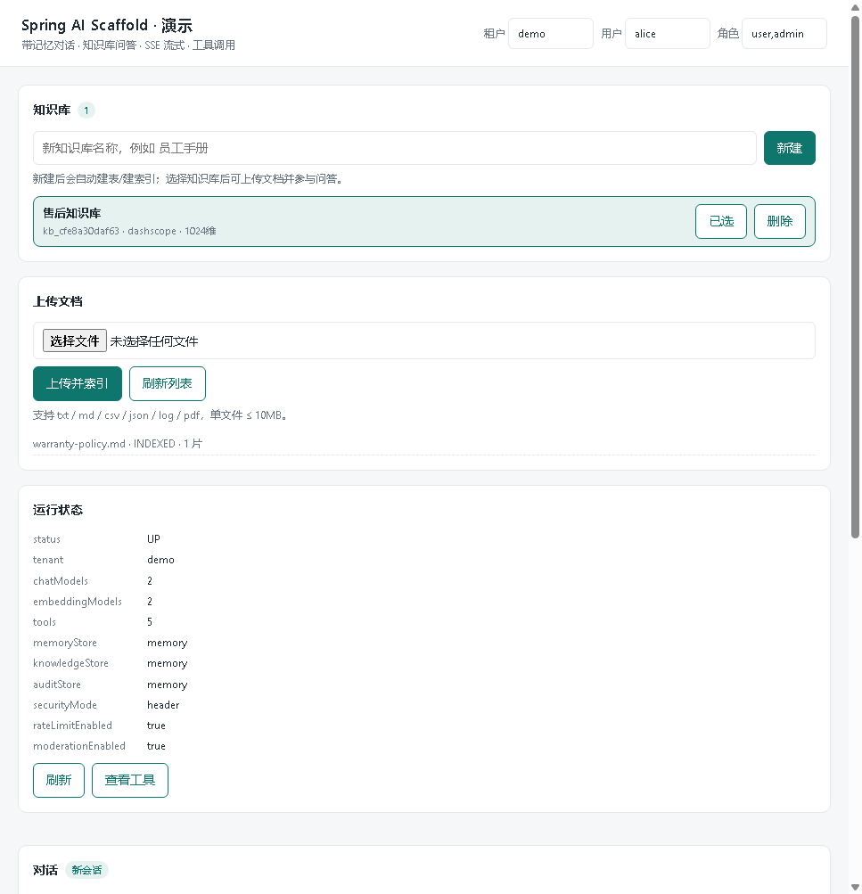
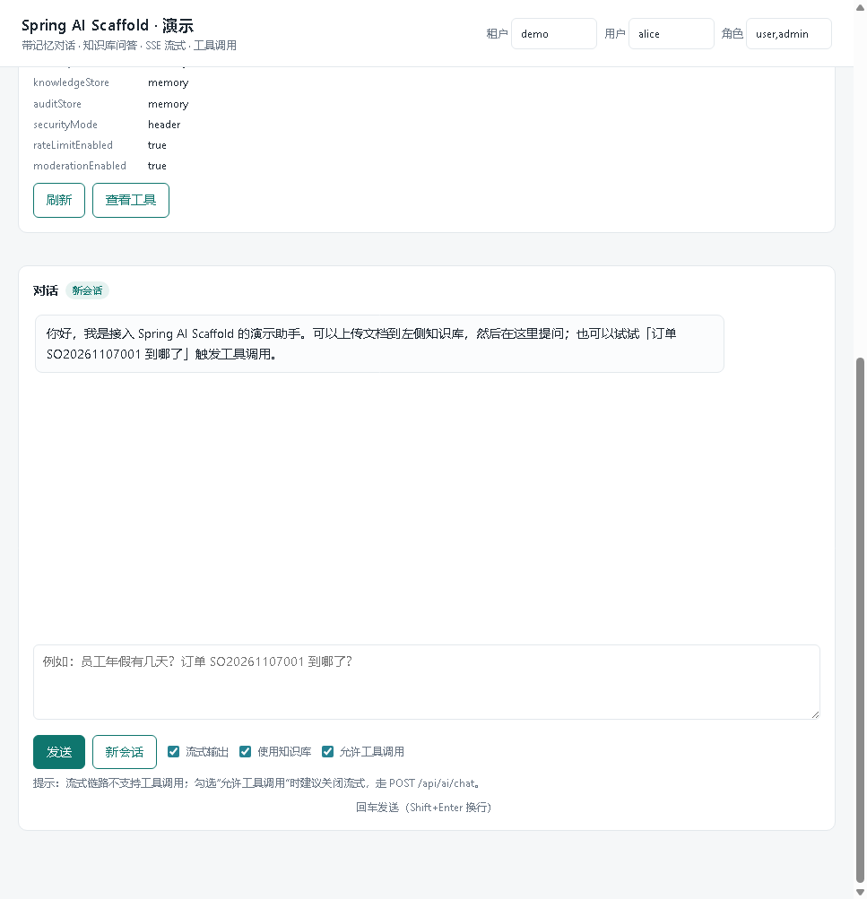

# spring-ai-scaffold

[English](README.en.md) | 简体中文


一个 Spring Boot starter：**引入依赖就拥有「带记忆的对话 + 可用的知识库问答」**，不依赖 `spring-ai` 官方库，只用 JDK 自带的 `java.net.http.HttpClient` 直连模型 HTTP 接口。

定位很朴素：给内部知识库问答、客服问答、企业内部 Copilot 这类需求，提供一个能直接改、能直接跑、依赖极少的起点。

<p align="center">
  
  
</p>

<p align="center"><i>demo 真实界面：上传文档 → 自动切分入库 → 勾选「使用知识库」提问。截图跑在本地 mock 模型上，不消耗真实额度。</i></p>


```
业务工程 (Spring Boot)  ──依赖──>  spring-ai-scaffold-starter
                                        │
                                        ├─ model    统一模型层（OpenAI 兼容 / DashScope 原生 / Ollama）
                                        ├─ memory   会话记忆（内存 / Redis / JDBC）
                                        ├─ rag      文档上传 → 切分 → 向量化 → 检索
                                        ├─ chat     编排：限流 → 审核 → 检索 → 工具循环 → 落库
                                        ├─ tool     @AiTool 注解注册函数调用
                                        └─ web      /chat、/chat/stream(SSE)、/kb …
```

## 为什么不用 Spring AI

- 依赖树干净：没有 `spring-ai-*` 一大串传递依赖，打包体积和冲突面都可控；
- 协议可控：模型请求体、SSE 解析、错误码映射都在本仓库里，出问题能直接改；
- 适配成本低：换供应商通常只改 `base-url` + `chat-model` 两个值。

代价是：没有 Spring AI 的 Advisor / VectorStore 抽象生态，多模态、复杂链路需要自己写。

## 能力边界

| 能力 | 本版（开源） | 企业版（不公开） |
| --- | --- | --- |
| 对话（非流式 / SSE 流式） | 支持 | 支持 |
| 会话记忆（内存 / Redis / JDBC） | 支持 | 支持 |
| 模型层（OpenAI 兼容 / DashScope 原生 / Ollama） | 支持 | 支持 |
| 知识库：上传 → 切分 → Embedding → 检索 | 支持（内存 / pgvector / Redis） | 支持 |
| 混合检索（向量 + 关键词） | 支持 | 支持 |
| 工具调用 `@AiTool` + 内置工具 | 支持（基础反射注册） | 支持 |
| 限流 / 关键词审核 / 审计 / token 统计 | 支持（本地实现） | 支持分布式实现 |
| 租户隔离 | header 透传（`X-Tenant-Id`） | API Key 鉴权 + RBAC |
| LLM 重排（rerank） | 只留 `Reranker` 接口 + `NoopReranker` | `LlmReranker` |
| 提示词版本管理（发布 / 灰度 / 回滚） | 只读 classpath `prompts/*.md` | `ai_prompt` 多版本 |
| Supervisor Agent / 任务规划 | 无 | 有 |
| MCP 工具接入 | 无 | 有 |
| 自动评估 / 幻觉检测 | 无 | 有 |
| 熔断降级 / 模型 fallback | 无 | 有 |
| 计费 / API Key / 管理后台 | 无 | 有 |

## 目录结构

```
spring-ai-scaffold/
├── pom.xml                         聚合 POM（Java 17 / Spring Boot 3.5.3 / UTF-8）
├── spring-ai-scaffold-starter/     starter：全部能力，自动配置在此
│   └── src/main/java/com/scaffoldai/
│       ├── autoconfigure/         自动配置 + 配置项
│       ├── model/                 模型抽象、HTTP 客户端、协议适配器
│       ├── memory/                会话记忆（内存 / Redis / JDBC）
│       ├── rag/                   解析、切分、向量库、检索
│       ├── chat/                  对话编排（非流式 + 流式）
│       ├── tool/                  @AiTool 注册与调用
│       ├── security/              租户上下文与过滤器
│       ├── moderation/ ratelimit/ audit/ metrics/
│       └── web/                   REST 接口、DTO、异常处理
├── spring-ai-scaffold-demo/       可运行 demo：上传文档 + 提问（含单页前端）
├── docs/                          截图、示例文档、发版说明
├── scripts/                       check-models.ps1 / mock-model-server.py
├── docker-compose.yml             本地 PostgreSQL(pgvector) 与 Redis
├── CHANGELOG.md / CONTRIBUTING.md  版本记录与贡献指南
```

## 快速开始

环境：JDK 17+、Maven 3.9+。以下命令以 Windows PowerShell 为例。

```powershell
# 1. 配置 API Key（DashScope / 阿里云百炼）
$env:DASHSCOPE_API_KEY = "sk-xxx"

# 2. 构建
cd D:\projects\spring-ai-scaffold-community
mvn -B -DskipTests package

# 3. 启动 demo
java -jar spring-ai-scaffold-demo\target\spring-ai-scaffold-demo-1.0.0.jar
```

打开 http://localhost:8080 ，页面里可以直接：

1. 新建知识库 → 上传 `.txt` / `.pdf`（会自动切分、向量化入库）；
2. 在对话框提问，勾选「使用知识库」即可带引用作答；
3. 勾选「流式」观察 SSE 逐字返回。

自检接口：

```powershell
curl.exe http://localhost:8080/api/ai/health -H "X-Tenant-Id: demo"
curl.exe http://localhost:8080/api/ai/models -H "X-Tenant-Id: demo"
```

想确认「配置的模型名在端点上确实存在」，启动后跑：

```powershell
.\scripts\check-models.ps1
```

它会对每个模型发一次真实请求，PASS / FAIL 一目了然。没有真实 Key 时可用本地 mock：

```powershell
python scripts\mock-model-server.py 9999    # 同时模拟 OpenAI 兼容与 DashScope 原生两套协议
```

然后把模型 `base-url` 指向 `http://127.0.0.1:9999`（兼容协议）或 `http://127.0.0.1:9999/api/v1`（原生协议），`api-key` 随便填。mock 会把请求体打印出来，正好能确认 `model` 字段到底发的是什么。

## 接入到自己的工程

```xml
<dependency>
    <groupId>com.scaffoldai</groupId>
    <artifactId>spring-ai-scaffold-starter</artifactId>
    <version>1.0.0</version>
</dependency>
```

自动配置会注册 `ChatService`、`Retriever`、`KnowledgeBaseService` 等 Bean，直接注入即可；不要 HTTP 接口时设 `ai.scaffold.web.enabled=false`，只当 SDK 用。

## 配置

最小配置（只用一个模型，最少依赖）：

```yaml
ai:
  scaffold:
    default-chat-model: dashscope
    default-embedding-model: dashscope
    models:
      dashscope:
        type: dashscope                        # openai-compatible / dashscope / dashscope-native / ollama
        base-url: https://dashscope.aliyuncs.com/compatible-mode/v1
        api-key: ${DASHSCOPE_API_KEY:}
        chat-model: qwen-plus                  # 供应商真实模型名，不能写逻辑名
        embedding-model: text-embedding-v4
        embedding-dimension: 1024
```

### 模型段（`models.<name>`）

| 配置 | 说明 |
| --- | --- |
| `type` | `openai-compatible`（绝大多数厂商）/ `dashscope`（兼容模式，实际等同 OpenAI 协议）/ `dashscope-native`（DashScope 原生 `/services/aigc/text-generation/generation`）/ `ollama` |
| `base-url` | 端点根地址；`dashscope` 填 `.../compatible-mode/v1`，`dashscope-native` 填 `.../api/v1` |
| `api-key` | 建议用环境变量占位，不要写死在仓库里 |
| `chat-model` | **供应商真实模型名**（`qwen-plus`、`qwen3.5-122b-a10b`、`qwen2.5:7b`） |
| `embedding-model` / `embedding-dimension` | 向量模型与其维度，必须与知识库建库时一致 |
| `temperature` / `max-tokens` / `timeout-seconds` / `connect-timeout-seconds` | 采样与超时 |
| `enabled` | `false` 时不注册该模型 |

`<name>` 是**逻辑名**，只用于注册表路由和审计；请求体里的 `model` 字段永远填 `chat-model` 的真实值。

### 其他段

| 配置 | 默认 | 说明 |
| --- | --- | --- |
| `chat.max-tool-rounds` | 4 | 工具调用最多几轮，防无限循环 |
| `chat.history-window` | 20 | 带进上下文的历史消息条数 |
| `chat.sse-timeout-seconds` | 120 | SSE 超时 |
| `chat.stream-executor-size` | 8 | 流式线程池大小 |
| `memory.store` | auto | `memory` / `redis` / `jdbc` / `auto` |
| `memory.max-messages` | 40 | 单会话保留条数 |
| `rag.store` | auto | `memory` / `pgvector` / `redis` / `auto` |
| `rag.top-k` / `rag.min-score` | 5 / 0.45 | 召回条数与相似度阈值 |
| `rag.chunk-size` / `rag.chunk-overlap` | 900 / 150 | 切分粒度 |
| `rag.hybrid-enabled` | true | 向量召回 + 关键词召回混合排序 |
| `security.mode` | header | 本版仅 header 透传 |
| `security.default-tenant` / `default-user` / `default-roles` | public / anonymous / user | 缺省身份 |
| `rate-limit.enabled` / `tenant-rpm` / `user-rpm` | true / 600 / 60 | 本地滑动窗口限流 |
| `moderation.enabled` / `max-input-chars` / `blocked-words` | true / 4000 / — | 关键词审核 + 长度限制 |
| `audit.enabled` / `store` / `truncate-length` | true / auto / 2000 | 审计落库 |
| `web.base-path` | /api/ai | 接口前缀 |
| `web.cors-allowed-origins` | * | 逗号分隔 |

存储选型建议：

- 会话记忆：单机 demo 用 `jdbc`；多实例/高并发用 `redis`。
- 知识库：demo 用 `memory`（重启即丢）；生产用 `pgvector`（需要 PostgreSQL + pgvector 扩展，`docker-compose.yml` 里已备好）。

## HTTP 接口

所有接口都在 `${ai.scaffold.web.base-path}`（默认 `/api/ai`）下，统一返回 `{"ok":true,"code":"OK","data":…}`。

| 方法 | 路径 | 说明 |
| --- | --- | --- |
| POST | `/chat` | 非流式对话，支持知识库、工具调用 |
| POST | `/chat/stream` | SSE 流式对话（不支持工具调用） |
| DELETE | `/chat/{conversationId}` | 清空某会话记忆 |
| GET | `/conversations` | 当前租户的会话列表 |
| GET | `/conversations/{id}/messages` | 某会话的消息 |
| POST | `/kb` | 新建知识库 |
| GET | `/kb` | 知识库列表 |
| GET / DELETE | `/kb/{kbId}` | 知识库详情 / 删除 |
| POST | `/kb/{kbId}/documents` | 上传文档（multipart，`.txt`/`.md`/`.pdf`） |
| GET / DELETE | `/kb/{kbId}/documents[/{docId}]` | 文档列表 / 详情 / 删除 |
| POST | `/kb/{kbId}/search` | 直接检索（调试召回质量） |
| GET | `/kb/{kbId}/chunks/count` | 切片数 |
| GET | `/models` / `/tools` / `/health` | 自检：模型清单、工具清单、运行状态 |

请求体（`POST /chat`）：

```json
{
  "question": "退货多久到账？",
  "conversationId": "c-1001",
  "model": "dashscope",
  "kbIds": ["kb-xxx"],
  "useRag": true,
  "useTools": true,
  "temperature": 0.3,
  "maxTokens": 1024,
  "systemPrompt": "你是售后客服"
}
```

`model` 填**逻辑名**（`models` 下的 key），不是供应商模型名。

租户与身份通过请求头透传：`X-Tenant-Id`、`X-User-Id`、`X-Roles`，缺省取配置里的默认值。

## 自定义工具（`@AiTool`）

在任意 Spring Bean 上标注方法即可被自动注册：

```java
@Component
public class OrderTools {

    @AiTool(name = "order_status", description = "按订单号查询物流状态。用户问『我的包裹到哪了』时调用。")
    public String orderStatus(
            @ToolParam("订单号，形如 SO2026001") String orderNo) {
        return "SF1234567890 已到达天津分拨中心";
    }
}
```

要点：

- `description` 决定模型会不会正确调用，写清「什么时候用」比写清「是什么」更重要；
- 参数依赖编译期 `-parameters`（本工程父 POM 已开启 `maven.compiler.parameters=true`），否则参数名会变成 `arg0`；
- 工具执行结果会回填给模型继续推理，最多 `chat.max-tool-rounds` 轮；
- 流式接口不做工具循环，需要工具时走非流式。

内置工具：`current_time`、`shipping_fee`、`order_status`、`refund_request`、`knowledge_search`（demo 里的示例实现，可整体替换）。

## 日志与排查

默认 `logging.level.root=WARN`、`com.scaffoldai=INFO`。想看「这次用的哪个模型、真实模型名、打到哪个地址、耗时多少 token」：

```powershell
java -jar spring-ai-scaffold-demo\target\spring-ai-scaffold-demo-1.0.0.jar --logging.level.com.scaffoldai=debug
```

**坑**：不要在 yml 里给子 logger（如 `com.scaffoldai.chat`、`com.scaffoldai.model`）单独写级别——子 logger 的显式级别会覆盖父级 DEBUG，导致上面这个命令行开关看起来「不生效」。

debug 下会看到模型调度、检索命中、限流与审核判定；`AiMetrics` 同时把 token 数与调用次数打到 Micrometer（`/actuator/metrics`）。

## 已知限制

- **SSE 不支持工具调用**：流式链路只做单轮补全，需要工具请用 `POST /chat`。
- **默认存储是进程内**：`rag.store=memory` 重启后知识库清空，`memory.store=memory` 同理；生产请配 pgvector / Redis / JDBC。
- **无重排**：只提供 `NoopReranker`（原序返回），要重排需自己实现 `Reranker` Bean 覆盖。
- **无鉴权**：header 透传意味着信任上游网关；直接暴露公网必须自己加鉴权。
- **限流是单机**：`InMemoryRateLimiter` 按实例计数，多实例要换 `RedisRateLimiter`。
- **提示词只读**：改提示词要改 `prompts/*.md` 并重启。
- 只支持文本与 PDF，图片/扫描件不做 OCR。

## FAQ

**1) `model_not_found`：`The model 'dashscope' does not exist`**

`models.dashscope` 的 key 是逻辑名，被当成模型名发给了供应商。检查是否有人把逻辑名填进了 `ChatRequest.model()` 或请求体 `model` 字段——那个字段要的是注册表 key，而请求体里的 `model` 必须是 `chat-model` 的真实值。正常情况下本脚手架会自动取 `provider.chatModel()`，出现该错误通常是自定义代码里手写了逻辑名。

**2) `401 You didn't provide an API key`**

`api-key` 没取到值。`${DASHSCOPE_API_KEY:}` 在环境变量为空时会解析成空串，请求就不带 `Authorization` 头。确认变量在**启动进程**里可见（改完环境变量要重启 IDE / 终端）。

**3) 换端点后 `404`**

`.../compatible-mode/v1/chat/completions` 与 `.../api/v1/services/aigc/text-generation/generation` 是两套协议，不能混用：

- 想用公共模型（`qwen-plus` 等）→ `type: dashscope` + `base-url: https://dashscope.aliyuncs.com/compatible-mode/v1`；
- 想用专属部署模型（如 `qwen3.5-122b-a10b`）→ `type: dashscope-native` + 该部署的 `/api/v1` 地址。

把兼容模式的地址配成专属部署端点，或反过来，都会得到 404 / `model_not_found`。

**4) 重启后知识库没了 / 会话丢了**

`rag.store`、`memory.store` 还是 `memory`（或 `auto` 但没配数据源，Spring Boot 给你配了个 H2 内存库）。要持久化就显式配 `jdbc` + `spring.datasource`，或 `pgvector` / `redis`。

**5) `mvn package` 报 `Unable to rename ... .jar.original`**

上一次启动的 demo 还占着 jar。先停进程再打包：

```powershell
Get-CimInstance Win32_Process -Filter "name='java.exe'" | Select-Object ProcessId, CommandLine
Stop-Process -Id <PID> -Force
```

## 参与贡献

Issue / PR 都欢迎。提交前请保证 `mvn -B -DskipTests package` 能过；新增能力请附带一个能跑通的 demo 或脚本。

## License

Apache License 2.0，见 [LICENSE](LICENSE)。
